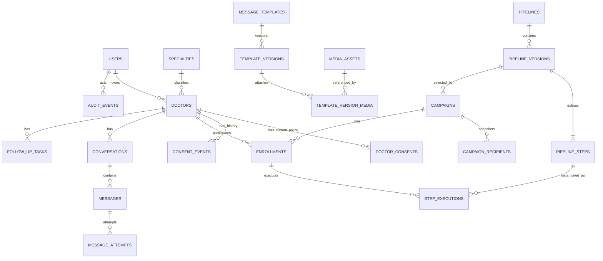

# DATABASE.md — AyuDevices Doctor Outreach & Relationship Automation Platform

**Document version:** 1.0  
**Companion documents:** `PRD.md`, `ARCHITECTURE.md`  
**Status:** Proposed database design for a new build  
**Primary database:** PostgreSQL  
**Migration tool:** Alembic (or an equivalent versioned migration tool)  
**Data ownership rule:** PostgreSQL is the authoritative source of truth; Redis is not authoritative storage.

---

## 1. Purpose

This document defines how AyuDevices stores operational data, how tables relate, which values must be immutable, and which database constraints protect the product from duplicate sends, invalid state transitions, and accidental loss of consent records.

It is a logical and implementation-oriented schema reference. The engineering team may adjust physical table names or split migrations during implementation, but must preserve the relationships, invariants, auditability, and state semantics defined here. All schema changes must be reviewed migrations; the application must not modify its schema at runtime.

### 1.1 Storage principles

1. **PostgreSQL is the source of truth.** Doctor records, consent, pipeline versions, campaign progress, messages, attempts, inbound events, and audits must survive application restarts.
2. **Normalize important relationships.** Use foreign keys for core entities. Use JSONB for genuinely variable configuration or provider metadata, not as a substitute for relational records that need constraints or queries.
3. **Append history; update projections.** Current consent and current object state may be updated, but consent events, message attempts, inbound provider events, and audit events are historical records and should not be casually overwritten or deleted.
4. **Configuration is distinct from execution.** Pipeline and template versions are snapshots; each campaign pins an approved pipeline version and each submitted message stores the exact rendered content used.
5. **Constraints are part of correctness.** Add unique constraints, foreign keys, check constraints, and indexes in the database as well as application validation.
6. **Never store provider credentials in plaintext application rows.** Store a secret-manager reference or encrypted-secret reference in provider configuration.
7. **No raw patient health data.** The system manages professional doctor relationships, not patient records or clinical encounter data.
8. **Store only what is needed.** Minimize personal information, redact logs, and apply documented retention and deletion rules.
9. **No false delivery certainty.** Persist provider-reported status separately from internal job state. A request being queued or submitted is not proof it was delivered.
10. **Fail closed.** When required consent or policy data cannot be read, outbound work must be blocked rather than treated as eligible.

---

## 2. Data Domains

| Domain | What it stores | Key tables |
|---|---|---|
| Identity and access | Users, role/status, sessions if server-managed | `users`, `user_sessions` |
| CRM | Doctor profile, specialties, tags, import history | `doctors`, `specialties`, `tags`, `doctor_tags`, `import_batches`, `import_rows` |
| Permission and suppression | Current permission per channel/purpose plus immutable events | `doctor_consents`, `consent_events` (including unresolved senders) |
| Messaging content | Templates, immutable versions, media metadata | `message_templates`, `template_versions`, `media_assets`, link tables |
| Automation configuration | Pipelines and versioned steps | `pipelines`, `pipeline_versions`, `pipeline_steps`, `pipeline_specialties` |
| Campaign execution | Campaigns, audience snapshot, individual enrollments and step runs | `campaigns`, `campaign_recipients`, `enrollments`, `step_executions` |
| Messaging and inbox | Conversations, messages, message attempts, incoming provider events | `conversations`, `messages`, `message_attachments`, `message_attempts`, `inbound_events` |
| Tasks and review | Follow-up tasks and optional AI/human review queue | `follow_up_tasks`, `review_items` |
| AI knowledge (P1) | Approved facts/document metadata and retrieval references | `knowledge_items`, `knowledge_chunks` or external vector-index references |
| Operations | Providers, global controls, reliable outbox, audit trail | `provider_configurations`, `automation_controls`, `outbox_events`, `audit_events` |

---

## 3. Entity Relationships



A doctor can have multiple consent records because permission is scoped by channel and purpose. A campaign snapshot records the selected recipients; an enrollment records runtime participation. A pipeline edit creates a new version and must not rewrite in-flight execution.

---

## 4. Database Conventions

### 4.1 Identifiers and timestamps

- Use UUID primary keys for application entities. Generate them in the database or application consistently.
- Use `TIMESTAMPTZ` for timestamps and persist instants in UTC. Convert to the configured display/business timezone in the UI.
- Use `created_at` and `updated_at` for mutable entities; historical event tables should use event-specific timestamps such as `occurred_at`, `received_at`, and `recorded_at`.
- Use `created_by`/`updated_by` where accountability is important. System-initiated operations should use an explicit actor type or system identity, not a fabricated user.
- Keep internal application state separate from provider state and provider status names.

### 4.2 Naming

- Use lowercase `snake_case` table and column names.
- Use plural table names consistently.
- Reference UUIDs through explicit foreign keys such as `doctor_id`, `pipeline_version_id`, and `message_id`.
- Prefer constrained text values or reference tables for statuses. If PostgreSQL ENUMs are used, define how forward migrations add values and how values are retired.
- Store flexible provider payload fragments in `JSONB` only after redaction and size limits; do not store access tokens, full secrets, or unnecessary personal data there.

### 4.3 Phone numbers

- Normalize phone numbers to E.164 form before matching, deduplication, and sending, e.g. `+919876543210`.
- Store the normalized number in `doctors.normalized_phone` and require a unique constraint if the product policy is one doctor record per normalized phone number.
- Preserve the original import input only when operationally necessary, and keep it in the import-row record with suitable access and retention controls.
- If a shared clinic number legitimately represents multiple records, do not silently weaken uniqueness. Use an explicit reviewed merge/association workflow and a documented model decision.

### 4.4 JSONB rules

Suitable JSONB uses include pipeline conditions, step-specific configuration, audience filters, redacted provider metadata, and capability declarations. Avoid JSONB for core state that needs independent uniqueness, foreign keys, reporting, or frequent filtering. Validate JSONB shapes through typed application schemas and versioned configuration formats.

---

## 5. Core Schema

The following SQL is a reference schema, not a substitute for reviewed migrations. Add extensions only where supported by the deployment. Adjust indexes based on measured query plans, but do not remove the safety-related unique constraints without an alternative guarantee.

### 5.1 Users

```sql
CREATE TABLE users (
    id UUID PRIMARY KEY DEFAULT gen_random_uuid(),
    full_name TEXT NOT NULL,
    email TEXT NOT NULL,
    password_hash TEXT,
    role TEXT NOT NULL CHECK (role IN ('owner', 'admin', 'sales_operator', 'reviewer', 'read_only')),
    status TEXT NOT NULL DEFAULT 'active' CHECK (status IN ('active', 'invited', 'disabled')),
    last_login_at TIMESTAMPTZ,
    created_at TIMESTAMPTZ NOT NULL DEFAULT now(),
    updated_at TIMESTAMPTZ NOT NULL DEFAULT now(),
    CONSTRAINT users_email_unique UNIQUE (email)
);

CREATE TABLE user_sessions (
    id UUID PRIMARY KEY DEFAULT gen_random_uuid(),
    user_id UUID NOT NULL REFERENCES users(id) ON DELETE CASCADE,
    session_token_hash TEXT NOT NULL UNIQUE,
    expires_at TIMESTAMPTZ NOT NULL,
    revoked_at TIMESTAMPTZ,
    created_at TIMESTAMPTZ NOT NULL DEFAULT now(),
    last_seen_at TIMESTAMPTZ
);
CREATE INDEX user_sessions_user_expiry_idx ON user_sessions(user_id, expires_at);
```

Authentication choice is an implementation decision. If an external identity provider is used, keep the local `users` identity/authorization mapping but do not store unused password hashes or duplicate the identity provider's secrets. Store only session-token hashes, never reusable raw session tokens.

### 5.2 Specialties, doctors, and tags

```sql
CREATE TABLE specialties (
    id UUID PRIMARY KEY DEFAULT gen_random_uuid(),
    display_name TEXT NOT NULL UNIQUE,
    active BOOLEAN NOT NULL DEFAULT TRUE,
    created_at TIMESTAMPTZ NOT NULL DEFAULT now(),
    updated_at TIMESTAMPTZ NOT NULL DEFAULT now()
);

CREATE TABLE doctors (
    id UUID PRIMARY KEY DEFAULT gen_random_uuid(),
    full_name TEXT NOT NULL,
    normalized_phone TEXT NOT NULL UNIQUE,
    specialty_id UUID REFERENCES specialties(id) ON DELETE RESTRICT,
    city TEXT,
    region TEXT,
    lead_source TEXT,
    relationship_stage TEXT NOT NULL DEFAULT 'new'
        CHECK (relationship_stage IN ('new', 'contacted', 'engaged', 'demo_requested', 'follow_up', 'converted', 'not_interested', 'archived')),
    assigned_user_id UUID REFERENCES users(id) ON DELETE SET NULL,
    product_interest TEXT,
    notes TEXT,
    last_inbound_at TIMESTAMPTZ,
    last_outbound_at TIMESTAMPTZ,
    next_action_at TIMESTAMPTZ,
    archived_at TIMESTAMPTZ,
    created_by UUID REFERENCES users(id) ON DELETE SET NULL,
    updated_by UUID REFERENCES users(id) ON DELETE SET NULL,
    created_at TIMESTAMPTZ NOT NULL DEFAULT now(),
    updated_at TIMESTAMPTZ NOT NULL DEFAULT now()
);
CREATE INDEX doctors_name_idx ON doctors (lower(full_name));
CREATE INDEX doctors_specialty_stage_idx ON doctors (specialty_id, relationship_stage);
CREATE INDEX doctors_assigned_user_idx ON doctors (assigned_user_id, relationship_stage);
CREATE INDEX doctors_next_action_idx ON doctors (next_action_at) WHERE archived_at IS NULL;

CREATE TABLE tags (
    id UUID PRIMARY KEY DEFAULT gen_random_uuid(),
    name TEXT NOT NULL UNIQUE,
    color TEXT,
    created_at TIMESTAMPTZ NOT NULL DEFAULT now()
);

CREATE TABLE doctor_tags (
    doctor_id UUID NOT NULL REFERENCES doctors(id) ON DELETE CASCADE,
    tag_id UUID NOT NULL REFERENCES tags(id) ON DELETE CASCADE,
    assigned_by UUID REFERENCES users(id) ON DELETE SET NULL,
    assigned_at TIMESTAMPTZ NOT NULL DEFAULT now(),
    PRIMARY KEY (doctor_id, tag_id)
);
```

Initial specialty seed data should include General Physician, Pediatrician, Cardiologist, Pulmonologist, Surgeon, Anesthesiologist, Orthopedic, Emergency Medicine, Gynecologist, Medical Student, Professor / Faculty, and Other / Unclassified. Seed rows are configurable; application behavior must not depend on hard-coded specialty IDs.

`normalized_phone` uniqueness is the default business rule. Any exception for shared numbers must be explicitly designed, audited, and tested rather than handled by silently creating duplicates.

### 5.3 Import batches and rows

```sql
CREATE TABLE import_batches (
    id UUID PRIMARY KEY DEFAULT gen_random_uuid(),
    source_file_name TEXT,
    source_checksum TEXT,
    initiated_by UUID REFERENCES users(id) ON DELETE SET NULL,
    status TEXT NOT NULL CHECK (status IN ('uploaded', 'validated', 'ready', 'committing', 'completed', 'completed_with_errors', 'failed', 'cancelled')),
    total_rows INTEGER NOT NULL DEFAULT 0 CHECK (total_rows >= 0),
    valid_rows INTEGER NOT NULL DEFAULT 0 CHECK (valid_rows >= 0),
    invalid_rows INTEGER NOT NULL DEFAULT 0 CHECK (invalid_rows >= 0),
    summary JSONB NOT NULL DEFAULT '{}'::jsonb,
    created_at TIMESTAMPTZ NOT NULL DEFAULT now(),
    completed_at TIMESTAMPTZ
);

CREATE TABLE import_rows (
    id UUID PRIMARY KEY DEFAULT gen_random_uuid(),
    batch_id UUID NOT NULL REFERENCES import_batches(id) ON DELETE CASCADE,
    row_number INTEGER NOT NULL CHECK (row_number > 0),
    normalized_phone TEXT,
    proposed_data JSONB NOT NULL DEFAULT '{}'::jsonb,
    validation_state TEXT NOT NULL CHECK (validation_state IN ('valid', 'invalid', 'duplicate', 'conflict', 'skipped', 'committed')),
    validation_errors JSONB NOT NULL DEFAULT '[]'::jsonb,
    matched_doctor_id UUID REFERENCES doctors(id) ON DELETE SET NULL,
    resulting_doctor_id UUID REFERENCES doctors(id) ON DELETE SET NULL,
    created_at TIMESTAMPTZ NOT NULL DEFAULT now(),
    UNIQUE (batch_id, row_number)
);
CREATE INDEX import_rows_batch_state_idx ON import_rows(batch_id, validation_state);
CREATE INDEX import_rows_phone_idx ON import_rows(normalized_phone);
```

Import procedure:

1. Upload and parse the file without writing doctor records.
2. Normalize phone numbers and validate required fields.
3. Detect duplicates within the file and matches in the database.
4. Show a preview and require the operator to choose create, update non-sensitive fields, skip, or resolve a conflict.
5. Never import or overwrite consent eligibility as an ordinary profile field.
6. Commit selected changes transactionally and record per-row results.
7. Keep enough import history to explain what happened, subject to the retention policy.

### 5.4 Current consent and immutable consent events

Consent must have one current state per doctor, channel, and purpose. The current-state table is a convenient authoritative projection for fast checks; the event table preserves the history and evidence.

```sql
CREATE TABLE doctor_consents (
    id UUID PRIMARY KEY DEFAULT gen_random_uuid(),
    doctor_id UUID NOT NULL REFERENCES doctors(id) ON DELETE RESTRICT,
    channel TEXT NOT NULL CHECK (channel IN ('whatsapp', 'email', 'phone', 'sms', 'other')),
    purpose TEXT NOT NULL,
    status TEXT NOT NULL CHECK (status IN ('opted_in', 'opted_out', 'pending_review', 'unknown')),
    consented_at TIMESTAMPTZ,
    source TEXT,
    evidence_ref TEXT,
    last_event_id UUID,
    updated_by UUID REFERENCES users(id) ON DELETE SET NULL,
    created_at TIMESTAMPTZ NOT NULL DEFAULT now(),
    updated_at TIMESTAMPTZ NOT NULL DEFAULT now(),
    UNIQUE (doctor_id, channel, purpose)
);
CREATE INDEX doctor_consents_eligibility_idx ON doctor_consents(channel, purpose, status, doctor_id);

CREATE TABLE consent_events (
    id UUID PRIMARY KEY DEFAULT gen_random_uuid(),
    doctor_id UUID REFERENCES doctors(id) ON DELETE RESTRICT,
    unresolved_sender_key TEXT,
    channel TEXT NOT NULL,
    purpose TEXT NOT NULL,
    event_type TEXT NOT NULL CHECK (event_type IN ('opt_in', 'opt_out', 'renewed_consent', 'scope_changed', 'ambiguous_request', 'status_imported', 'manual_review', 'correction')),
    status_after_event TEXT CHECK (status_after_event IN ('opted_in', 'opted_out', 'pending_review', 'unknown')),
    source TEXT NOT NULL,
    evidence_ref TEXT,
    original_message_id UUID,
    actor_type TEXT NOT NULL CHECK (actor_type IN ('user', 'system', 'provider', 'import')),
    actor_user_id UUID REFERENCES users(id) ON DELETE SET NULL,
    occurred_at TIMESTAMPTZ,
    recorded_at TIMESTAMPTZ NOT NULL DEFAULT now(),
    metadata JSONB NOT NULL DEFAULT '{}'::jsonb,
    CHECK (doctor_id IS NOT NULL OR unresolved_sender_key IS NOT NULL)
);
CREATE INDEX consent_events_doctor_time_idx ON consent_events(doctor_id, recorded_at DESC);
CREATE INDEX consent_events_unresolved_idx ON consent_events(unresolved_sender_key, recorded_at DESC)
    WHERE doctor_id IS NULL;
```

After creating `messages`, add the following foreign keys in a migration:

```sql
ALTER TABLE doctor_consents
    ADD CONSTRAINT doctor_consents_last_event_fk
    FOREIGN KEY (last_event_id) REFERENCES consent_events(id) ON DELETE SET NULL;

ALTER TABLE consent_events
    ADD CONSTRAINT consent_events_original_message_fk
    FOREIGN KEY (original_message_id) REFERENCES messages(id) ON DELETE SET NULL;
```

Operational rules:

- An unknown or missing consent record is not eligible for promotional sending.
- Imports cannot change `doctor_consents` unless a separate authorized consent-import procedure is executed with evidence and an audit event.
- On opt-out, create the event and update the current state in one transaction, then cancel/suppress queued campaign steps and follow-ups. The final send gate must still re-check consent immediately before sending.
- A clear opt-out must not be undone by a stale import or a delayed older event.
- Renewed consent requires documented evidence and a newly authorized event; an operator cannot simply toggle an opt-out off without history.
- If the sender cannot be matched confidently, record an unresolved event and suppress promotional replies for that sender until reviewed.
- Access to evidence and original-message references should be restricted. Do not copy unnecessary message bodies into `metadata`.

### 5.5 Media assets and storage references

```sql
CREATE TABLE media_assets (
    id UUID PRIMARY KEY DEFAULT gen_random_uuid(),
    file_name TEXT NOT NULL,
    mime_type TEXT NOT NULL,
    size_bytes BIGINT NOT NULL CHECK (size_bytes >= 0),
    checksum_sha256 TEXT NOT NULL,
    storage_provider TEXT NOT NULL,
    storage_key TEXT NOT NULL,
    validation_state TEXT NOT NULL DEFAULT 'pending'
        CHECK (validation_state IN ('pending', 'valid', 'rejected', 'scan_failed')),
    status TEXT NOT NULL DEFAULT 'active' CHECK (status IN ('active', 'archived', 'deleted')),
    metadata JSONB NOT NULL DEFAULT '{}'::jsonb,
    owner_id UUID REFERENCES users(id) ON DELETE SET NULL,
    created_at TIMESTAMPTZ NOT NULL DEFAULT now(),
    archived_at TIMESTAMPTZ,
    UNIQUE (storage_provider, storage_key)
);
CREATE INDEX media_assets_status_idx ON media_assets(status, validation_state);
CREATE INDEX media_assets_checksum_idx ON media_assets(checksum_sha256);
```

Store media bytes in local storage in development and an object-storage adapter in production. PostgreSQL stores metadata, checksum, and a storage reference—not large binary media. Verify real content type, enforce configurable size/type limits, and scan files where supported. Do not treat a storage key or a public URL as authorization. Use backend authorization or short-lived signed URLs.

### 5.6 Message templates and immutable versions

```sql
CREATE TABLE message_templates (
    id UUID PRIMARY KEY DEFAULT gen_random_uuid(),
    name TEXT NOT NULL,
    channel TEXT NOT NULL CHECK (channel IN ('whatsapp', 'email', 'sms', 'other')),
    purpose TEXT NOT NULL,
    language_code TEXT NOT NULL DEFAULT 'en',
    approval_state TEXT NOT NULL DEFAULT 'draft'
        CHECK (approval_state IN ('draft', 'pending_review', 'approved', 'rejected', 'archived')),
    provider_template_id TEXT,
    provider_status TEXT,
    current_version_id UUID,
    owner_id UUID REFERENCES users(id) ON DELETE SET NULL,
    reviewer_id UUID REFERENCES users(id) ON DELETE SET NULL,
    created_at TIMESTAMPTZ NOT NULL DEFAULT now(),
    updated_at TIMESTAMPTZ NOT NULL DEFAULT now(),
    archived_at TIMESTAMPTZ
);
CREATE INDEX message_templates_channel_purpose_idx ON message_templates(channel, purpose, approval_state);

CREATE TABLE template_versions (
    id UUID PRIMARY KEY DEFAULT gen_random_uuid(),
    template_id UUID NOT NULL REFERENCES message_templates(id) ON DELETE RESTRICT,
    version_number INTEGER NOT NULL CHECK (version_number > 0),
    body TEXT,
    content_config JSONB NOT NULL DEFAULT '{}'::jsonb,
    placeholder_schema JSONB NOT NULL DEFAULT '{}'::jsonb,
    provider_approval_snapshot JSONB NOT NULL DEFAULT '{}'::jsonb,
    status TEXT NOT NULL CHECK (status IN ('draft', 'pending_review', 'approved', 'rejected', 'superseded')),
    created_by UUID REFERENCES users(id) ON DELETE SET NULL,
    approved_by UUID REFERENCES users(id) ON DELETE SET NULL,
    approved_at TIMESTAMPTZ,
    created_at TIMESTAMPTZ NOT NULL DEFAULT now(),
    UNIQUE (template_id, version_number)
);

CREATE TABLE template_version_media (
    template_version_id UUID NOT NULL REFERENCES template_versions(id) ON DELETE RESTRICT,
    media_asset_id UUID NOT NULL REFERENCES media_assets(id) ON DELETE RESTRICT,
    display_order INTEGER NOT NULL DEFAULT 0,
    role TEXT,
    PRIMARY KEY (template_version_id, media_asset_id)
);

ALTER TABLE message_templates
    ADD CONSTRAINT message_templates_current_version_fk
    FOREIGN KEY (current_version_id) REFERENCES template_versions(id) ON DELETE SET NULL;
```

Template version behavior:

- Editing a template creates a new version; it must not mutate a version used by a submitted message.
- Only approved versions can be selected for live campaigns, subject to the selected provider's requirements.
- Track provider approval status separately from internal business approval. An internally approved message is not automatically a provider-approved WhatsApp template.
- Define and validate placeholders, required values, escaping, and missing-variable behavior before campaign launch.
- Never invent product claims, clinical claims, pricing, or offers. Content must come from operator-provided and approved data.

### 5.7 Pipelines and immutable versions

```sql
CREATE TABLE pipelines (
    id UUID PRIMARY KEY DEFAULT gen_random_uuid(),
    name TEXT NOT NULL,
    description TEXT,
    purpose TEXT NOT NULL DEFAULT 'doctor_outreach',
    status TEXT NOT NULL DEFAULT 'draft' CHECK (status IN ('draft', 'active', 'paused', 'archived')),
    current_version_id UUID,
    owner_id UUID REFERENCES users(id) ON DELETE SET NULL,
    created_at TIMESTAMPTZ NOT NULL DEFAULT now(),
    updated_at TIMESTAMPTZ NOT NULL DEFAULT now(),
    archived_at TIMESTAMPTZ
);

CREATE TABLE pipeline_versions (
    id UUID PRIMARY KEY DEFAULT gen_random_uuid(),
    pipeline_id UUID NOT NULL REFERENCES pipelines(id) ON DELETE RESTRICT,
    version_number INTEGER NOT NULL CHECK (version_number > 0),
    configuration_snapshot JSONB NOT NULL DEFAULT '{}'::jsonb,
    validation_result JSONB NOT NULL DEFAULT '{}'::jsonb,
    status TEXT NOT NULL CHECK (status IN ('draft', 'pending_review', 'approved', 'rejected', 'retired')),
    created_by UUID REFERENCES users(id) ON DELETE SET NULL,
    approved_by UUID REFERENCES users(id) ON DELETE SET NULL,
    approved_at TIMESTAMPTZ,
    created_at TIMESTAMPTZ NOT NULL DEFAULT now(),
    UNIQUE (pipeline_id, version_number)
);

CREATE TABLE pipeline_steps (
    id UUID PRIMARY KEY DEFAULT gen_random_uuid(),
    pipeline_version_id UUID NOT NULL REFERENCES pipeline_versions(id) ON DELETE RESTRICT,
    step_key TEXT NOT NULL,
    step_order INTEGER NOT NULL CHECK (step_order > 0),
    name TEXT NOT NULL,
    step_type TEXT NOT NULL CHECK (step_type IN ('send_message', 'send_media', 'wait', 'condition', 'create_task', 'request_review', 'end')),
    template_version_id UUID REFERENCES template_versions(id) ON DELETE RESTRICT,
    delay_seconds BIGINT NOT NULL DEFAULT 0 CHECK (delay_seconds >= 0),
    conditions JSONB NOT NULL DEFAULT '{}'::jsonb,
    step_config JSONB NOT NULL DEFAULT '{}'::jsonb,
    retry_policy JSONB NOT NULL DEFAULT '{}'::jsonb,
    approval_required BOOLEAN NOT NULL DEFAULT FALSE,
    created_at TIMESTAMPTZ NOT NULL DEFAULT now(),
    UNIQUE (pipeline_version_id, step_key),
    UNIQUE (pipeline_version_id, step_order)
);

CREATE TABLE pipeline_step_media (
    pipeline_step_id UUID NOT NULL REFERENCES pipeline_steps(id) ON DELETE RESTRICT,
    media_asset_id UUID NOT NULL REFERENCES media_assets(id) ON DELETE RESTRICT,
    display_order INTEGER NOT NULL DEFAULT 0,
    PRIMARY KEY (pipeline_step_id, media_asset_id)
);

CREATE TABLE pipeline_specialties (
    pipeline_id UUID NOT NULL REFERENCES pipelines(id) ON DELETE CASCADE,
    specialty_id UUID NOT NULL REFERENCES specialties(id) ON DELETE RESTRICT,
    is_default BOOLEAN NOT NULL DEFAULT FALSE,
    created_at TIMESTAMPTZ NOT NULL DEFAULT now(),
    PRIMARY KEY (pipeline_id, specialty_id)
);
CREATE UNIQUE INDEX pipeline_one_default_per_specialty_idx
    ON pipeline_specialties(specialty_id) WHERE is_default = TRUE;

ALTER TABLE pipelines
    ADD CONSTRAINT pipelines_current_version_fk
    FOREIGN KEY (current_version_id) REFERENCES pipeline_versions(id) ON DELETE SET NULL;

CREATE INDEX pipeline_steps_version_order_idx ON pipeline_steps(pipeline_version_id, step_order);
```

Rules:

- A pipeline is an editable container. An approved `pipeline_versions` row is an immutable snapshot.
- A version's step definitions and referenced template/media versions cannot be edited after approval; create a new version instead.
- Each specialty may map to at most one default pipeline. A pipeline can be mapped to multiple specialties when explicitly configured.
- Campaigns and enrollments pin a specific pipeline version. Publishing a newer version must not silently alter live campaigns.
- Use deterministic step types and validated configuration schemas; do not evaluate arbitrary code stored in `conditions` or `step_config`.

### 5.8 Campaigns, audience snapshots, enrollments, and step executions

```sql
CREATE TABLE campaigns (
    id UUID PRIMARY KEY DEFAULT gen_random_uuid(),
    name TEXT NOT NULL,
    description TEXT,
    pipeline_version_id UUID NOT NULL REFERENCES pipeline_versions(id) ON DELETE RESTRICT,
    audience_definition JSONB NOT NULL DEFAULT '{}'::jsonb,
    status TEXT NOT NULL DEFAULT 'draft'
        CHECK (status IN ('draft', 'pending_approval', 'scheduled', 'running', 'paused', 'completed', 'cancelled', 'failed')),
    timezone TEXT NOT NULL DEFAULT 'Asia/Kolkata',
    scheduled_at TIMESTAMPTZ,
    launched_by UUID REFERENCES users(id) ON DELETE SET NULL,
    approved_by UUID REFERENCES users(id) ON DELETE SET NULL,
    approved_at TIMESTAMPTZ,
    started_at TIMESTAMPTZ,
    ended_at TIMESTAMPTZ,
    pause_reason TEXT,
    created_at TIMESTAMPTZ NOT NULL DEFAULT now(),
    updated_at TIMESTAMPTZ NOT NULL DEFAULT now()
);
CREATE INDEX campaigns_status_schedule_idx ON campaigns(status, scheduled_at);

CREATE TABLE campaign_recipients (
    id UUID PRIMARY KEY DEFAULT gen_random_uuid(),
    campaign_id UUID NOT NULL REFERENCES campaigns(id) ON DELETE CASCADE,
    doctor_id UUID NOT NULL REFERENCES doctors(id) ON DELETE RESTRICT,
    eligibility_at_preview TEXT NOT NULL
        CHECK (eligibility_at_preview IN ('eligible', 'blocked', 'unknown')),
    preview_reason TEXT,
    doctor_snapshot JSONB NOT NULL DEFAULT '{}'::jsonb,
    consent_snapshot JSONB NOT NULL DEFAULT '{}'::jsonb,
    selection_state TEXT NOT NULL DEFAULT 'included'
        CHECK (selection_state IN ('included', 'excluded', 'needs_review')),
    created_at TIMESTAMPTZ NOT NULL DEFAULT now(),
    UNIQUE (campaign_id, doctor_id)
);
CREATE INDEX campaign_recipients_campaign_state_idx ON campaign_recipients(campaign_id, selection_state);

CREATE TABLE enrollments (
    id UUID PRIMARY KEY DEFAULT gen_random_uuid(),
    campaign_id UUID NOT NULL REFERENCES campaigns(id) ON DELETE RESTRICT,
    doctor_id UUID NOT NULL REFERENCES doctors(id) ON DELETE RESTRICT,
    pipeline_version_id UUID NOT NULL REFERENCES pipeline_versions(id) ON DELETE RESTRICT,
    status TEXT NOT NULL DEFAULT 'pending'
        CHECK (status IN ('pending', 'active', 'paused', 'blocked', 'completed', 'cancelled', 'failed')),
    current_step_order INTEGER,
    next_due_at TIMESTAMPTZ,
    paused_reason TEXT,
    started_at TIMESTAMPTZ,
    completed_at TIMESTAMPTZ,
    created_at TIMESTAMPTZ NOT NULL DEFAULT now(),
    updated_at TIMESTAMPTZ NOT NULL DEFAULT now(),
    UNIQUE (campaign_id, doctor_id)
);
CREATE INDEX enrollments_due_idx ON enrollments(status, next_due_at) WHERE status IN ('pending', 'active');
CREATE INDEX enrollments_doctor_status_idx ON enrollments(doctor_id, status);
CREATE INDEX enrollments_campaign_status_idx ON enrollments(campaign_id, status);

CREATE TABLE step_executions (
    id UUID PRIMARY KEY DEFAULT gen_random_uuid(),
    enrollment_id UUID NOT NULL REFERENCES enrollments(id) ON DELETE RESTRICT,
    pipeline_step_id UUID NOT NULL REFERENCES pipeline_steps(id) ON DELETE RESTRICT,
    step_key_snapshot TEXT NOT NULL,
    step_order_snapshot INTEGER NOT NULL CHECK (step_order_snapshot > 0),
    state TEXT NOT NULL DEFAULT 'pending'
        CHECK (state IN ('pending', 'ready', 'running', 'waiting', 'completed', 'skipped', 'blocked', 'failed', 'uncertain', 'cancelled')),
    due_at TIMESTAMPTZ,
    started_at TIMESTAMPTZ,
    completed_at TIMESTAMPTZ,
    attempt_count INTEGER NOT NULL DEFAULT 0 CHECK (attempt_count >= 0),
    result_summary JSONB NOT NULL DEFAULT '{}'::jsonb,
    safe_error_code TEXT,
    safe_error_detail TEXT,
    created_at TIMESTAMPTZ NOT NULL DEFAULT now(),
    updated_at TIMESTAMPTZ NOT NULL DEFAULT now(),
    UNIQUE (enrollment_id, pipeline_step_id)
);
CREATE INDEX step_executions_due_idx ON step_executions(state, due_at) WHERE state IN ('pending', 'ready', 'waiting');
CREATE INDEX step_executions_enrollment_idx ON step_executions(enrollment_id, step_order_snapshot);
```

`campaign_recipients` is the reviewed audience snapshot; it is not the live source of consent. Current consent must be read again at execution time. `enrollments` tracks the doctor's participation. `step_executions` tracks an individual step, its due time, and its result.

For the MVP, assume a linear pipeline with one execution per enrollment/step. If conditional branches can cause a step to repeat, revisit the uniqueness constraint and add a durable run/iteration identifier. Do not implement loops by deleting old execution history.

### 5.9 Conversations and messages

```sql
CREATE TABLE conversations (
    id UUID PRIMARY KEY DEFAULT gen_random_uuid(),
    doctor_id UUID NOT NULL REFERENCES doctors(id) ON DELETE RESTRICT,
    channel TEXT NOT NULL CHECK (channel IN ('whatsapp', 'email', 'sms', 'other')),
    provider_conversation_ref TEXT,
    assigned_user_id UUID REFERENCES users(id) ON DELETE SET NULL,
    status TEXT NOT NULL DEFAULT 'open' CHECK (status IN ('open', 'waiting', 'resolved', 'archived')),
    automation_paused BOOLEAN NOT NULL DEFAULT FALSE,
    human_takeover BOOLEAN NOT NULL DEFAULT FALSE,
    last_message_at TIMESTAMPTZ,
    created_at TIMESTAMPTZ NOT NULL DEFAULT now(),
    updated_at TIMESTAMPTZ NOT NULL DEFAULT now()
);
CREATE INDEX conversations_doctor_last_message_idx ON conversations(doctor_id, last_message_at DESC);
CREATE INDEX conversations_assignment_status_idx ON conversations(assigned_user_id, status, last_message_at DESC);

CREATE TABLE messages (
    id UUID PRIMARY KEY DEFAULT gen_random_uuid(),
    doctor_id UUID NOT NULL REFERENCES doctors(id) ON DELETE RESTRICT,
    conversation_id UUID NOT NULL REFERENCES conversations(id) ON DELETE RESTRICT,
    direction TEXT NOT NULL CHECK (direction IN ('inbound', 'outbound')),
    channel TEXT NOT NULL CHECK (channel IN ('whatsapp', 'email', 'sms', 'other')),
    provider_configuration_id UUID,
    provider_message_id TEXT,
    message_type TEXT NOT NULL DEFAULT 'text' CHECK (message_type IN ('text', 'image', 'video', 'document', 'audio', 'template', 'interactive', 'other')),
    template_version_id UUID REFERENCES template_versions(id) ON DELETE RESTRICT,
    body_snapshot TEXT,
    provider_status TEXT,
    state TEXT NOT NULL CHECK (state IN ('draft', 'queued', 'sending', 'submitted', 'sent', 'delivered', 'read', 'failed', 'uncertain', 'skipped', 'cancelled')),
    status_source TEXT,
    error_code TEXT,
    error_detail_safe TEXT,
    created_by UUID REFERENCES users(id) ON DELETE SET NULL,
    created_at TIMESTAMPTZ NOT NULL DEFAULT now(),
    queued_at TIMESTAMPTZ,
    submitted_at TIMESTAMPTZ,
    sent_at TIMESTAMPTZ,
    delivered_at TIMESTAMPTZ,
    read_at TIMESTAMPTZ,
    failed_at TIMESTAMPTZ,
    updated_at TIMESTAMPTZ NOT NULL DEFAULT now()
);
CREATE INDEX messages_conversation_time_idx ON messages(conversation_id, created_at DESC);
CREATE INDEX messages_doctor_time_idx ON messages(doctor_id, created_at DESC);
CREATE INDEX messages_state_time_idx ON messages(state, created_at);
CREATE INDEX messages_template_version_idx ON messages(template_version_id);

CREATE TABLE message_attachments (
    message_id UUID NOT NULL REFERENCES messages(id) ON DELETE RESTRICT,
    media_asset_id UUID NOT NULL REFERENCES media_assets(id) ON DELETE RESTRICT,
    display_order INTEGER NOT NULL DEFAULT 0,
    file_name_snapshot TEXT,
    mime_type_snapshot TEXT,
    checksum_snapshot TEXT,
    PRIMARY KEY (message_id, media_asset_id)
);
```

After `provider_configurations` is created, add the provider foreign key and a partial unique index:

```sql
ALTER TABLE messages
    ADD CONSTRAINT messages_provider_configuration_fk
    FOREIGN KEY (provider_configuration_id) REFERENCES provider_configurations(id) ON DELETE RESTRICT;

CREATE UNIQUE INDEX messages_provider_id_unique_idx
    ON messages(provider_configuration_id, provider_message_id)
    WHERE provider_message_id IS NOT NULL;
```

Message rules:

- `body_snapshot` is the exact rendered content recorded for that send attempt. Later template edits never rewrite it.
- The attachment join preserves media references and metadata snapshots used at send time. If media must be deleted from active storage, retain enough permitted metadata to interpret historical messages.
- Keep provider-confirmed status in `provider_status`/status events and internal execution status in `state`; normalize provider events without discarding the original safe event type.
- Only set `delivered_at` or `read_at` when the provider supplies the corresponding confirmed event. Do not infer read/delivery from a successful HTTP response.
- Provider message IDs may be missing before submission or unsupported by some providers; use idempotency keys and attempt records as well.

### 5.10 Message attempts and inbound events

```sql
CREATE TABLE message_attempts (
    id UUID PRIMARY KEY DEFAULT gen_random_uuid(),
    message_id UUID NOT NULL REFERENCES messages(id) ON DELETE RESTRICT,
    idempotency_key TEXT NOT NULL UNIQUE,
    attempt_number INTEGER NOT NULL CHECK (attempt_number > 0),
    state TEXT NOT NULL CHECK (state IN ('started', 'accepted', 'rejected', 'failed', 'uncertain')),
    request_metadata_redacted JSONB NOT NULL DEFAULT '{}'::jsonb,
    result_metadata_redacted JSONB NOT NULL DEFAULT '{}'::jsonb,
    provider_request_id TEXT,
    error_code TEXT,
    error_detail_safe TEXT,
    started_at TIMESTAMPTZ NOT NULL DEFAULT now(),
    completed_at TIMESTAMPTZ,
    UNIQUE (message_id, attempt_number)
);
CREATE INDEX message_attempts_message_time_idx ON message_attempts(message_id, started_at DESC);
CREATE INDEX message_attempts_state_idx ON message_attempts(state, started_at);

CREATE TABLE inbound_events (
    id UUID PRIMARY KEY DEFAULT gen_random_uuid(),
    provider_configuration_id UUID,
    provider_event_id TEXT,
    provider_message_id TEXT,
    sender_key TEXT,
    event_type TEXT NOT NULL,
    payload_hash TEXT NOT NULL,
    redacted_payload JSONB NOT NULL DEFAULT '{}'::jsonb,
    received_at TIMESTAMPTZ NOT NULL DEFAULT now(),
    processed_at TIMESTAMPTZ,
    process_state TEXT NOT NULL DEFAULT 'received'
        CHECK (process_state IN ('received', 'processing', 'processed', 'ignored', 'failed', 'needs_review')),
    retry_count INTEGER NOT NULL DEFAULT 0 CHECK (retry_count >= 0),
    safe_error TEXT
);
CREATE INDEX inbound_events_unprocessed_idx ON inbound_events(received_at) WHERE process_state IN ('received', 'failed');
CREATE INDEX inbound_events_sender_time_idx ON inbound_events(sender_key, received_at DESC);
CREATE INDEX inbound_events_provider_message_idx ON inbound_events(provider_message_id);
```

After `provider_configurations` exists, add its foreign key and a partial uniqueness rule for provider event IDs:

```sql
ALTER TABLE inbound_events
    ADD CONSTRAINT inbound_events_provider_configuration_fk
    FOREIGN KEY (provider_configuration_id) REFERENCES provider_configurations(id) ON DELETE RESTRICT;

CREATE UNIQUE INDEX inbound_events_provider_event_unique_idx
    ON inbound_events(provider_configuration_id, provider_event_id)
    WHERE provider_event_id IS NOT NULL;
```

Rules:

- Verify webhook signatures before accepting provider events into the trusted processing path.
- Persist each event before returning success to the provider when practical; process it asynchronously after persistence.
- Deduplicate events using provider event ID when available. Use a documented fallback based on provider message ID, event type, and payload hash if provider event IDs are absent.
- Store only redacted payloads necessary for operation and debugging. If raw payload retention is needed, encrypt it, tightly restrict access, and define an explicit retention period.
- A failed inbound processing job may be retried idempotently; it must not create a duplicate message or repeat an opt-out side effect.

### 5.11 Follow-up tasks

```sql
CREATE TABLE follow_up_tasks (
    id UUID PRIMARY KEY DEFAULT gen_random_uuid(),
    doctor_id UUID NOT NULL REFERENCES doctors(id) ON DELETE RESTRICT,
    conversation_id UUID REFERENCES conversations(id) ON DELETE RESTRICT,
    enrollment_id UUID REFERENCES enrollments(id) ON DELETE RESTRICT,
    owner_id UUID REFERENCES users(id) ON DELETE SET NULL,
    task_type TEXT NOT NULL CHECK (task_type IN ('send_message', 'call', 'schedule_demo', 'review_reply', 'manual_follow_up', 'other')),
    status TEXT NOT NULL DEFAULT 'pending' CHECK (status IN ('pending', 'scheduled', 'in_progress', 'completed', 'cancelled', 'blocked', 'failed')),
    due_at TIMESTAMPTZ NOT NULL,
    reason TEXT,
    notes TEXT,
    created_by UUID REFERENCES users(id) ON DELETE SET NULL,
    completed_by UUID REFERENCES users(id) ON DELETE SET NULL,
    completed_at TIMESTAMPTZ,
    cancelled_at TIMESTAMPTZ,
    created_at TIMESTAMPTZ NOT NULL DEFAULT now(),
    updated_at TIMESTAMPTZ NOT NULL DEFAULT now()
);
CREATE INDEX follow_up_tasks_due_idx ON follow_up_tasks(status, due_at) WHERE status IN ('pending', 'scheduled', 'in_progress');
CREATE INDEX follow_up_tasks_doctor_idx ON follow_up_tasks(doctor_id, due_at DESC);
CREATE INDEX follow_up_tasks_owner_idx ON follow_up_tasks(owner_id, status, due_at);
```

A task is a durable record, not permission to send. If the task causes a message, the execution service must re-check current consent, campaign state, recipient, business hours, limits, and template/provider constraints. Opt-out should cancel or block relevant promotional tasks.

### 5.12 Human review queue and AI knowledge (P1)

```sql
CREATE TABLE review_items (
    id UUID PRIMARY KEY DEFAULT gen_random_uuid(),
    conversation_id UUID NOT NULL REFERENCES conversations(id) ON DELETE RESTRICT,
    inbound_message_id UUID REFERENCES messages(id) ON DELETE RESTRICT,
    intent TEXT,
    confidence NUMERIC(5,4) CHECK (confidence IS NULL OR (confidence >= 0 AND confidence <= 1)),
    reason TEXT NOT NULL,
    retrieved_sources JSONB NOT NULL DEFAULT '[]'::jsonb,
    draft TEXT,
    proposed_action JSONB NOT NULL DEFAULT '{}'::jsonb,
    status TEXT NOT NULL DEFAULT 'pending' CHECK (status IN ('pending', 'approved', 'edited_and_approved', 'rejected', 'handled', 'cancelled')),
    reviewer_id UUID REFERENCES users(id) ON DELETE SET NULL,
    reviewer_note TEXT,
    created_at TIMESTAMPTZ NOT NULL DEFAULT now(),
    reviewed_at TIMESTAMPTZ
);
CREATE INDEX review_items_status_time_idx ON review_items(status, created_at);

CREATE TABLE knowledge_items (
    id UUID PRIMARY KEY DEFAULT gen_random_uuid(),
    item_type TEXT NOT NULL CHECK (item_type IN ('product_fact', 'price', 'offer', 'policy', 'document', 'faq', 'other')),
    title TEXT NOT NULL,
    structured_value JSONB NOT NULL DEFAULT '{}'::jsonb,
    document_media_asset_id UUID REFERENCES media_assets(id) ON DELETE RESTRICT,
    source_description TEXT,
    status TEXT NOT NULL DEFAULT 'draft' CHECK (status IN ('draft', 'pending_review', 'approved', 'rejected', 'expired', 'archived')),
    effective_from TIMESTAMPTZ,
    effective_until TIMESTAMPTZ,
    approved_by UUID REFERENCES users(id) ON DELETE SET NULL,
    reviewed_at TIMESTAMPTZ,
    created_by UUID REFERENCES users(id) ON DELETE SET NULL,
    created_at TIMESTAMPTZ NOT NULL DEFAULT now(),
    updated_at TIMESTAMPTZ NOT NULL DEFAULT now(),
    CHECK (effective_until IS NULL OR effective_from IS NULL OR effective_until > effective_from)
);
CREATE INDEX knowledge_items_approved_effective_idx
    ON knowledge_items(status, effective_from, effective_until)
    WHERE status = 'approved';
```

If retrieval chunks are stored in PostgreSQL, add a `knowledge_chunks` table with `knowledge_item_id`, `chunk_number`, text/extract metadata, and an optional vector column only if the chosen database extension is deliberately deployed. If Qdrant or another vector store is used, PostgreSQL remains authoritative for the source item, approval state, effective dates, and document metadata; the vector index is rebuildable and must never be the source of truth for pricing or permission.

Expired or unapproved items must not be returned as approved facts. Every AI-generated message that requires knowledge should preserve references to retrieved items in the review/audit record. AI features remain disabled by default until explicitly configured.

### 5.13 Provider configuration

```sql
CREATE TABLE provider_configurations (
    id UUID PRIMARY KEY DEFAULT gen_random_uuid(),
    provider_type TEXT NOT NULL,
    display_name TEXT NOT NULL,
    channel TEXT NOT NULL CHECK (channel IN ('whatsapp', 'email', 'sms', 'other')),
    secret_reference TEXT NOT NULL,
    status TEXT NOT NULL DEFAULT 'disabled' CHECK (status IN ('disabled', 'active', 'degraded', 'invalid')),
    capabilities JSONB NOT NULL DEFAULT '{}'::jsonb,
    safe_diagnostics JSONB NOT NULL DEFAULT '{}'::jsonb,
    last_health_check_at TIMESTAMPTZ,
    created_at TIMESTAMPTZ NOT NULL DEFAULT now(),
    updated_at TIMESTAMPTZ NOT NULL DEFAULT now()
);
CREATE INDEX provider_configurations_channel_status_idx ON provider_configurations(channel, status);
```

`secret_reference` points to a secret manager, deployment secret, or encrypted secret entry. It must not contain the actual access token or secret. Avoid exposing provider identifiers or diagnostics to unauthorized users. Keep provider-specific capabilities such as delivery/read webhooks, media support, template requirements, and idempotency support in `capabilities` after validating them against the chosen provider.

### 5.14 Global automation controls

```sql
CREATE TABLE automation_controls (
    id SMALLINT PRIMARY KEY CHECK (id = 1),
    outbound_enabled BOOLEAN NOT NULL DEFAULT FALSE,
    ai_enabled BOOLEAN NOT NULL DEFAULT FALSE,
    draft_only BOOLEAN NOT NULL DEFAULT TRUE,
    emergency_stop BOOLEAN NOT NULL DEFAULT TRUE,
    allowed_timezone TEXT NOT NULL DEFAULT 'Asia/Kolkata',
    policy_config JSONB NOT NULL DEFAULT '{}'::jsonb,
    updated_by UUID REFERENCES users(id) ON DELETE SET NULL,
    updated_at TIMESTAMPTZ NOT NULL DEFAULT now()
);

INSERT INTO automation_controls (id) VALUES (1) ON CONFLICT (id) DO NOTHING;
```

This is the persisted system-level control record. Every worker must read or reliably refresh the current value before an outbound side effect. Do not rely only on a cached frontend setting or Redis flag. Only authorized roles may change controls, and each change must produce an audit event. Conservative defaults keep sending and AI disabled until a deliberate setup action enables them.

### 5.15 Reliable outbox

A database transaction and a queue publish are not one atomic operation. Use a transactional outbox when an operation must reliably schedule work.

```sql
CREATE TABLE outbox_events (
    id UUID PRIMARY KEY DEFAULT gen_random_uuid(),
    aggregate_type TEXT NOT NULL,
    aggregate_id UUID NOT NULL,
    event_type TEXT NOT NULL,
    payload JSONB NOT NULL DEFAULT '{}'::jsonb,
    state TEXT NOT NULL DEFAULT 'pending' CHECK (state IN ('pending', 'publishing', 'published', 'failed')),
    available_at TIMESTAMPTZ NOT NULL DEFAULT now(),
    attempts INTEGER NOT NULL DEFAULT 0 CHECK (attempts >= 0),
    last_error_safe TEXT,
    created_at TIMESTAMPTZ NOT NULL DEFAULT now(),
    published_at TIMESTAMPTZ
);
CREATE INDEX outbox_events_due_idx ON outbox_events(state, available_at) WHERE state IN ('pending', 'failed');
```

In one transaction, save the business change and its outbox event. A dispatcher publishes pending events to Redis/Celery and marks them published. If publishing fails, the event remains retryable. Consumers must be idempotent because an event may be published more than once. The outbox schedules work; it does not replace `step_executions` or other authoritative domain state.

### 5.16 Audit events

```sql
CREATE TABLE audit_events (
    id UUID PRIMARY KEY DEFAULT gen_random_uuid(),
    actor_type TEXT NOT NULL CHECK (actor_type IN ('user', 'system', 'provider', 'worker', 'ai')),
    actor_id UUID,
    action TEXT NOT NULL,
    object_type TEXT NOT NULL,
    object_id UUID,
    result TEXT NOT NULL CHECK (result IN ('success', 'blocked', 'failure', 'partial')),
    reason_code TEXT,
    correlation_id TEXT,
    redacted_metadata JSONB NOT NULL DEFAULT '{}'::jsonb,
    occurred_at TIMESTAMPTZ NOT NULL DEFAULT now()
);
CREATE INDEX audit_events_object_time_idx ON audit_events(object_type, object_id, occurred_at DESC);
CREATE INDEX audit_events_actor_time_idx ON audit_events(actor_type, actor_id, occurred_at DESC);
CREATE INDEX audit_events_action_time_idx ON audit_events(action, occurred_at DESC);
CREATE INDEX audit_events_correlation_idx ON audit_events(correlation_id) WHERE correlation_id IS NOT NULL;
```

Audit events are append-only from the application's point of view. Restrict update/delete permissions for the database role used by the application. If corrections are required, insert a new corrective event instead of rewriting history. Do not store passwords, access tokens, complete provider secrets, or unnecessary message contents in audit metadata.

---

## 6. State, Transaction, and Concurrency Rules

### 6.1 Outbound send transaction sequence

Do not keep a long database transaction open while making a network request to WhatsApp. Use a short-transaction state machine:

1. Claim a due `step_executions` row using a transaction and row locking (for example, `FOR UPDATE SKIP LOCKED`).
2. Re-read the enrollment, campaign, conversation, global controls, and current consent data.
3. Evaluate the centralized policy gate. If blocked, persist the block reason and do not call the provider.
4. Render the content from an approved, pinned template version; confirm required provider template/attachment constraints.
5. Create or update the `messages` record and create a `message_attempts` record with a unique idempotency key before the external side effect.
6. Commit the database transaction before making the network call.
7. Call the provider through the adapter.
8. Persist the response and normalized status in a new transaction.
9. If the outcome is ambiguous, mark `uncertain` and reconcile using provider IDs/status lookup where supported. Never blindly retry an uncertain request.
10. Advance the pipeline only according to documented state transitions and actual provider response semantics.

The final eligibility check must occur as close as practical to the external side effect. For policies requiring stronger serialization with opt-out, use an explicit locking/transaction strategy and define the trade-off between latency and race prevention. No queued job itself grants permission to send.

### 6.2 Claiming due work

Use a short transaction to select and claim due records, for example with `FOR UPDATE SKIP LOCKED`, then set a lease/`running` state and commit. Add a lease-expiration or stale-job recovery strategy so a worker crash does not strand work indefinitely. Do not hold row locks while waiting on an external provider.

If a dedicated `job_leases` table is needed by implementation, it must include job key, lease owner, lease expiry, heartbeat/update time, and attempt count; it must not become the only storage of domain status.

### 6.3 Idempotency and duplicate prevention

Use the following protections together:

- A unique key for one enrollment per campaign and doctor.
- A unique step execution for each enrollment/step for linear MVP pipelines.
- A unique idempotency key for every provider request attempt.
- Unique provider message/event IDs when supplied.
- Idempotent inbound event processors.
- Transactional state changes before outbox publication.
- Reconciliation for provider results that remain uncertain.

Idempotency keys should be generated from a durable execution/message identity plus attempt identity, not from message text alone. Do not create a new provider attempt simply because a queue delivery was duplicated.

### 6.4 State transition ownership

Centralize transitions in domain services, with check constraints for valid values and tests for valid paths. Examples:

- A cancelled step cannot return to `ready` without an authorized manual action that records actor, reason, prior state, and new state.
- A failed step retries only when the error class is explicitly retryable and the retry limit has not been reached.
- An uncertain send cannot be retried automatically unless provider reconciliation establishes that the earlier request was not accepted.
- An opt-out updates consent and creates a consent event in one transaction; dependent work is then cancelled or blocked.
- A new pipeline version does not mutate an in-flight enrollment.
- A message is not marked delivered/read without provider evidence.

### 6.5 Transaction boundaries

Use transactions for:

- Doctor creation/update plus corresponding audit record where required.
- Import commits and row-level outcomes.
- Consent-event append plus current-consent projection update.
- Pipeline/template version publication and approval.
- Campaign launch plus audience/enrollment snapshots plus outbox event.
- Step claim and persisted message/attempt creation.
- Message status updates from provider events plus event-processing state.
- Follow-up creation/cancellation where linked state changes must remain consistent.

Do not use distributed transactions across PostgreSQL, Redis, object storage, a messaging provider, and an LLM. Use idempotent adapters, the outbox pattern, status reconciliation, and explicit uncertainty states instead.

---

## 7. Key Constraints and Index Strategy

Indexes listed in the schema are starting points. Validate them with `EXPLAIN (ANALYZE, BUFFERS)` against realistic data and add only indexes supported by access patterns.

| Query / operation | Initial index or constraint |
|---|---|
| Doctor lookup by phone | Unique index on `doctors.normalized_phone` |
| Doctor search/filter | `lower(full_name)`, specialty/stage, assigned user, due action |
| Current eligibility | `doctor_consents(channel, purpose, status, doctor_id)` and unique `(doctor_id, channel, purpose)` |
| Consent history | `(doctor_id, recorded_at DESC)` |
| Find campaigns due to start | `(status, scheduled_at)` |
| Find due executions | Partial index on `(state, due_at)` for pending/ready/waiting states |
| Track enrollment progress | Campaign/status and doctor/status indexes |
| Conversation inbox | Assignment/status and chronological message indexes |
| Message timeline | `(conversation_id, created_at DESC)` |
| Provider message reconciliation | Partial unique `(provider_configuration_id, provider_message_id)` |
| Inbound webhook dedupe | Partial unique `(provider_configuration_id, provider_event_id)` |
| Retry / failure investigations | Message attempt state/time indexes |
| Follow-up queue | Partial index on task status/due time |
| Review queue | `(status, created_at)` |
| Audit trail | Object/time, actor/time, action/time, correlation ID |
| Outbox dispatcher | Partial index on state/available time |

Use pagination for large tables, preferably keyset/cursor pagination for conversations and audit history. Avoid unbounded `SELECT *` from message/audit tables. Analytics pages should use aggregate queries or read models rather than loading every message into the API process.

---

## 8. Data Retention, Deletion, and Privacy

Create a documented retention matrix before production. The exact legal and contractual periods must be confirmed by the operator for the business and jurisdiction; do not invent a universal retention period in code.

| Data class | Default treatment | Deletion/retention considerations |
|---|---|---|
| Doctor profiles | Archive rather than hard-delete during normal operations | Keep only required professional/business fields. Review downstream links before purge. |
| Consent events and suppression history | Append-only and access-restricted | Preserve as needed to honor opt-outs and applicable obligations. Do not erase an opt-out simply because a doctor record is archived. |
| Templates and approved versions | Preserve version history | Submitted message snapshots must remain interpretable. Archive unused versions rather than rewriting them. |
| Media bytes | Store outside PostgreSQL | Delete/expire files according to policy; preserve minimal metadata where needed for history/audit. Avoid broken signed/public links. |
| Messages and attempts | Restrict access and retain according to approved policy | Redact sensitive content where legally and operationally appropriate; preserve status evidence and dedupe IDs for the approved period. |
| Inbound webhook payloads | Minimize and redact | Prefer hashes and normalized fields over full payload retention. Encrypt any raw-payload archive and set a short, documented lifetime if required. |
| Audit events | Append-only | Retain for the defined operational/compliance period. Do not use logs as a second copy of secrets or full conversation text. |
| Sessions and security events | Expire/revoke promptly | Delete expired session-token hashes according to security policy. |
| AI drafts/retrieval references | Retain only as needed | Avoid using conversation data for model training unless separately authorized and properly governed. |

### 8.1 Archive versus purge

- **Archive** hides an entity from normal workflows while preserving referential integrity and history.
- **Purge** is a separately authorized process that must check dependencies, retention rules, and legal holds.
- Never cascade-delete a doctor, consent event, message, or campaign merely to simplify UI deletion.
- Keep the minimum suppression information needed to prevent re-contact after opt-out, consistent with applicable law and documented policy.
- Provide a process to export or erase eligible personal data where required; log the request and outcome without preserving unnecessary copies of the data that was erased.

### 8.2 Backups

- Encrypt database backups and restrict access.
- Define recovery point objective (RPO) and recovery time objective (RTO) before production launch.
- Test restoration regularly, including media-object reconciliation and migration replay.
- Do not use production data in development fixtures. Use synthetic or appropriately redacted data.

---

## 9. Security Controls for the Database

1. Keep database credentials out of source control, frontend code, logs, and documentation examples.
2. Use separate database roles for migrations, application runtime, reporting/read-only use, and backups where practical.
3. The runtime role should not have permission to alter schema; migrations use a separate role.
4. Restrict direct UPDATE/DELETE access to append-only tables such as `consent_events`, `message_attempts`, `inbound_events` history where applicable, and `audit_events`.
5. Use TLS for database connections in hosted environments.
6. Apply least-privilege API authorization before returning contact, consent, conversation, or audit data.
7. Use field-level redaction for application logs and error responses. Never log passwords, tokens, raw authorization headers, or complete provider secrets.
8. Use parameterized queries or an ORM; never build SQL from untrusted input.
9. Validate uploaded metadata and file content before creating active media references.
10. Consider PostgreSQL row-level security only if the final tenant/isolation model needs it; do not add RLS as decorative security without tests and a documented policy.
11. If multi-tenant hosting is introduced later, add explicit tenant IDs and tenant-scoped unique keys/foreign keys in a planned migration before sharing one database among tenants.
12. Database-level backups, migrations, and diagnostic access must be audited and limited to authorized operators.

---

## 10. Migration and Seed Strategy

### 10.1 Migrations

Use Alembic revisions (or an equivalent versioned system) for:

- Table and index creation.
- Foreign keys and constraints.
- Data backfills.
- New status values or schema-format versions.
- Retention-related changes.
- Safe index creation for large production tables.

Each migration should state its purpose and operational risk. Prefer expand-and-contract migrations for breaking changes: add new nullable fields/tables, deploy compatible code, backfill, validate, then enforce constraints or remove obsolete fields in a later migration. Do not depend on ORM `create_all()` in production as the schema-management strategy.

### 10.2 Seed data

Seed only non-secret baseline data:

- Initial specialty rows.
- The single `automation_controls` row with safe disabled defaults.
- Optional fake/demo templates and pipelines clearly marked as examples/drafts.
- No real doctor contacts, live phone numbers, real consent evidence, or production provider secrets.

Seed scripts must be idempotent: rerunning them should update or skip known seed values without creating duplicate specialties, tags, settings, or example records.

### 10.3 Local setup

Document commands equivalent to:

```bash
# Apply approved migrations
alembic upgrade head

# Create an initial administrator using a safe CLI or invite flow
python -m app.cli create-admin

# Seed baseline non-production reference data
python -m app.cli seed
```

These are example command names. The implementation team should make the actual commands consistent with the repository and document them in the README.

---

## 11. Data Lifecycle Examples

### 11.1 Create a doctor and record consent

1. Normalize and validate the phone number.
2. Create or find the doctor by normalized phone.
3. Assign a specialty and owner as permitted.
4. Record current channel/purpose consent status. A new record with no valid evidence remains `unknown` or `pending_review`, not `opted_in`.
5. Append the supporting `consent_events` row if a consent event occurred.
6. Write an audit event for important changes.

### 11.2 Configure and publish a specialty pipeline

1. Create/edit the `pipelines` editorial record.
2. Create a new `pipeline_versions` row.
3. Add ordered `pipeline_steps` and approved template/media references.
4. Validate required placeholders, timing, step configuration, content approvals, provider constraints, and branching rules.
5. Record review/approval and set the pipeline's current version.
6. Update `pipeline_specialties` mapping in an authorized transaction.
7. Never mutate a published version already referenced by a campaign.

### 11.3 Launch a campaign

1. Create the campaign in draft state and pin an approved `pipeline_version_id`.
2. Evaluate the audience and write a `campaign_recipients` snapshot, including the preview result and reason.
3. Require launch approval when configured.
4. Create enrollments for selected recipients, subject to the approved rules and a current eligibility check.
5. Create the initial step executions with durable due times.
6. Write the campaign launch audit event and an outbox event in the same transaction.
7. Workers wake up from the queue but re-read authoritative state before sending.

### 11.4 Process an opt-out

1. Persist the incoming provider event and dedupe it.
2. Identify the sender; if matched, append a `consent_events` record and update `doctor_consents` in one transaction. If not matched confidently, append a `consent_events` row with `doctor_id = NULL` and an opaque `unresolved_sender_key`, then route it for manual review and conservatively suppress outreach.
3. Pause/block the relevant conversation and cancel/suppress campaign steps and promotional follow-ups.
4. Append an audit event and schedule any permitted confirmation through the same outbound policy service.
5. Ensure all workers re-check current consent immediately before any later send.

### 11.5 Reconcile uncertain send

1. Keep the original `message_attempts` row and mark the result `uncertain`.
2. Do not create a blind duplicate attempt.
3. Query provider status or reconcile by provider request/message IDs if the provider supports it.
4. Persist a provider-confirmed result or leave the record visibly uncertain for human review.
5. Write an audit record for manual resolution, including actor, reason, and selected outcome.

---

## 12. Required Database Tests

The implementation is not complete until automated tests verify at least the following:

### Schema and constraints

- Normalized phone number cannot be duplicated under the MVP one-phone-one-doctor rule.
- Specialty and referenced records cannot be hard-deleted while referenced by history.
- Unique current consent per doctor/channel/purpose is enforced.
- Event and version history remains after updates to current-state projections.
- One default pipeline per specialty is enforced.
- Template and pipeline version numbers are unique within their parent.
- One recipient/enrollment per doctor per campaign is enforced.
- Duplicate provider message/event identifiers are rejected when present.
- Message-attempt idempotency keys are unique.

### Transactions and concurrency

- Consent event and current state cannot commit separately.
- Campaign launch and initial work/outbox records cannot partially commit.
- Two workers cannot successfully claim and execute the same due step simultaneously.
- Duplicate webhook deliveries do not create duplicate messages or repeated opt-out side effects.
- An opt-out occurring after campaign scheduling blocks a later send.
- A stale worker lease can be recovered without producing a duplicate provider request.
- Uncertain provider outcomes are not blindly retried.

### Snapshots and history

- Editing a template does not change previously rendered message bodies.
- Publishing a new pipeline version does not change existing campaign/enrollment references.
- Recipient preview history is retained, but the live send decision uses current consent.
- Audit events are recorded for launch, pause/resume/cancel, consent changes, manual overrides, and review actions.
- Deactivating a specialty does not erase doctors or historic campaigns.

### Privacy and operations

- Logs and audit metadata redact secrets and unnecessary raw provider payloads.
- Runtime database role cannot run schema migrations or rewrite immutable history.
- Backup restoration and migration replay are documented and exercised in a test environment.
- Database indexes support the expected doctor, due-work, inbox, and audit queries under a realistic test dataset.

---

## 13. Implementation Sequence

Build the database in the same dependency order as `PRD.md` and `ARCHITECTURE.md`:

1. **Foundation:** migrations, users, specialties, doctors, tags, audit events, global automation controls.
2. **Consent:** current consent state, append-only consent events, eligibility query/service, concurrency tests.
3. **Content:** media assets, templates, immutable template versions, pipelines, pipeline versions, step configuration, specialty mappings.
4. **Campaign execution:** campaigns, audience snapshots, enrollments, step executions, outbox, due-work indexes.
5. **Messaging:** conversations, messages, attachments, message attempts, provider configurations, inbound event deduplication.
6. **Operations:** follow-up tasks, retention support, indexes, monitoring queries, backup/restore procedures.
7. **P1:** review items, knowledge items/chunks, retrieval references, AI audit metadata.
8. **P2:** integration synchronization tables only when a specific integration is approved and designed.

Do not create every future table just to make the initial migration large. Build each domain when its implementation phase starts, but keep migration naming, foreign-key patterns, event semantics, and the invariants in this document consistent.

---

## 14. Definition of Database Done

The database layer is ready for the initial production pilot when:

- All deployed schema changes are managed by reviewed migrations.
- Core records and execution state persist across API/worker restarts.
- PostgreSQL is the sole authority for current consent and campaign/message state.
- Current consent and its immutable event history are consistently maintained.
- Pipeline/template versions and message content snapshots remain historically stable.
- Campaign recipients, enrollments, step executions, and message attempts are distinct and queryable.
- Duplicate rows, duplicate event processing, and duplicate provider attempts are blocked by constraints and idempotent logic.
- Uncertain provider results remain visible and recoverable instead of causing blind retries.
- Audit events capture critical operator/system actions without exposing secrets.
- Indexes cover key CRM, eligibility, inbox, due-work, and audit queries.
- Retention, backup, and restore policies are documented and tested.
- Unit, integration, concurrency, and recovery tests pass.

**The database must make correct behavior durable and auditable; it must not rely on the frontend, the queue, or the AI model to preserve business rules.**
